# TOTEM ZMK config: Miryoku-style layout with Windows and Mac modes

ZMK firmware for the 38-key wireless [TOTEM](https://github.com/GEIGEIGEIST/TOTEM)
with a Seeed Studio XIAO nRF52840 in each half, running a QWERTY layout built
on the [Miryoku](https://github.com/manna-harbour/miryoku) layers.

- QWERTY letters on all 38 keys, home row mods, Miryoku-style layers
- Home row mods that react as soon as you press another key (no fixed wait)
- Windows mode (default, also right for Samsung DeX) and a Mac mode with
  native Mac shortcuts
- ZMK Studio for changing keys without reflashing
- Battery level of both halves reported over Bluetooth
- Deep sleep after 30 minutes without use (on battery)
- Built on ZMK v0.3 (the current stable release)

## Layout

```
         ┌─────┬─────┬─────┬─────┬─────┐   ┌─────┬─────┬─────┬─────┬─────┐
         │  Q  │  W  │  E  │  R  │  T  │   │  Y  │  U  │  I  │  O  │  '  │
         ├─────┼─────┼─────┼─────┼─────┤   ├─────┼─────┼─────┼─────┼─────┤
         │  A  │  S  │  D  │  F  │  G  │   │  H  │  J  │  K  │  L  │  P  │
         │ Win │ Alt │Ctrl │Shift│     │   │     │Shift│Ctrl │ Alt │ Win │
   ┌─────┼─────┼─────┼─────┼─────┼─────┤   ├─────┼─────┼─────┼─────┼─────┼─────┐
   │ Esc │  Z  │  X  │  C  │  V  │  B  │   │  N  │  M  │  ,  │  .  │  ;  │Bksp │
   │     │     │AltGr│     │     │     │   │     │     │     │AltGr│     │     │
   └─────┴─────┴─────┼─────┼─────┼─────┤   ├─────┼─────┼─────┼─────┴─────┴─────┘
                     │  `  │ Tab │Space│   │Enter│  /  │  \  │
                     │ Btn │ Nav │Mouse│   │ Sym │ Num │ Fun │
                     └─────┴─────┴─────┘   └─────┴─────┴─────┘
```

Tap a key for the top label, hold it for the bottom label. `-` and `=` are on
the Num layer, `[` and `]` too (Shift gives `{` and `}`).

Holding a thumb key switches the *other* hand to a new layer, and turns the
home row of the *same* hand into modifiers:

| Hold          | Other hand gets                                                              |
|---------------|------------------------------------------------------------------------------|
| Tab → Nav     | arrows (J K L P row: ←, ↓, ↑, →), Home/PgDn/PgUp/End, Insert, redo/paste/copy/cut/undo; Enter, `/`, `\` on the thumbs. H locks Nav ([see below](#nav-lock)) |
| Space → Mouse | mouse movement, scroll wheel; right thumbs are mouse buttons                 |
| Enter → Sym   | `{ & * ( )` / `} $ % ^ +` / `! @ # _`: the Num keys with Shift; Caps Lock where Num has `.` |
| / → Num       | `[ 7 8 9 0` / `] 4 5 6 =` / `. 1 2 3 -` (`.` under `]`)                       |
| \ → Fun       | F1–F12 in the same spots as the digits (F10–F12 where `0 = -` are), Menu    |
| `` ` `` → Media | both hands. Left: undo/cut/copy/paste/redo, media keys (mute, volume, previous/next, play/pause on G). Right: screen brightness, Bluetooth and USB ([see below](#bluetooth-profiles)), mouse buttons on the thumbs |

Num, Sym and Fun keep Tab and Space on their usual left thumb keys, and Nav
has Enter, `/` and `\` on the right thumbs, so holding these repeats them
(on Base, holding them switches layers instead).

On Nav, Mouse and Media the outer pinky keys are **Print Screen** (left) and
**Delete** (right). Caps Word (capitals
until the end of the word) is on the G key of Nav; with Shift it's Caps Lock.

Undo, cut, copy, paste, redo always come in that order from the pinky inwards,
mirrored on the right hand (Nav and Mouse). On the left hand (Media) that puts
them on Z, X, C, V and B, like Ctrl+Z/X/C/V.

Nav and Mouse also have double-tap locks for Sym, Num and Fun on C, V and B (the
same order as their thumb keys): the layer stays on until you double tap Base on
its top row.

All layers (Windows mode; held keys are shaded, "2×" keys need a double tap):



### Nav lock

Hold Tab and tap **H**: Nav stays on after you let go of Tab, so you can move
around with one hand. Tap **H** again to go back to Base. (Behind the scenes
this is a separate layer, "Nav Lock", a copy of Nav.)

### Home row mods

A home row key turns into its modifier as soon as you press **and release**
another key while holding it, so Shift+letter works at full typing speed. Held
on its own (for example Shift+click), it becomes the modifier after 200 ms
(150 ms for Shift).

- Let go of the letter before the modifier. If the modifier comes up first
  (within 200 ms, 150 ms for Shift), you get both letters; that's what keeps quick rolls like
  "fo" from turning into "O".
- To keep Win, Alt, Ctrl and AltGr from triggering by accident while you type,
  a home row key pressed within 125 ms of the previous key is always a letter.
  Shift (F and J) skips this pause, so a capital right after a space works
  however fast you type.
- To repeat a letter on a home row key, tap it, then hold it.
- The thumb layer keys keep Miryoku's timing: they switch layers
  once held for 200 ms.

The numbers can be tuned, see [Customizing](#customizing).

### More layers

One more base layer exists but is only reached on purpose, by double tapping
its key on Nav or Mouse: **Tap**, the same letters with no hold functions.

More about the layout:
[Miryoku reference](https://github.com/manna-harbour/miryoku/tree/master/docs/reference).

## Windows and Mac mode

The keyboard always starts in **Windows mode**.

| To switch to | Press together            |
|--------------|---------------------------|
| Mac mode     | all 3 **right** thumb keys |
| Windows mode | all 3 **left** thumb keys  |

Mac mode is the same layout with Mac-native modifiers and shortcuts:

| | Windows mode | Mac mode |
|---|---|---|
| Hold A / P | Win | Ctrl |
| Hold S / L | Alt | Option |
| Hold D / K | Ctrl | Cmd |
| Hold F / J | Shift | Shift |
| Undo, Cut, Copy, Paste | Ctrl+Z / X / C / V | Cmd+Z / X / C / V |
| Redo | Ctrl+Y | Shift+Cmd+Z |
| Print Screen | Print Screen | Shift+Cmd+4 |

So the finger you hold for Ctrl on Windows holds Cmd on a Mac: copy is
D+C (or K+C) in both modes.

After a restart or waking from deep sleep the keyboard is back in Windows
mode.

## Flashing firmware

### Get the firmware

Every push to this repository builds the firmware.

1. Open the **Actions** tab on GitHub and select the latest **Build ZMK firmware** run.
2. Download the **firmware** zip under *Artifacts* and unzip it. It contains:
   - `totem_left-seeeduino_xiao_ble-zmk.uf2`: left half
   - `totem_right-seeeduino_xiao_ble-zmk.uf2`: right half
   - `settings_reset-seeeduino_xiao_ble-zmk.uf2`: wipes pairings and ZMK Studio changes

### Put a half into flashing mode

1. Connect that half to the computer with a USB-C cable.
2. **Double-press the reset button** on the top of the XIAO. A single press only restarts it.
3. A USB drive (named like `XIAO-SENSE`) appears.
4. Copy the `.uf2` file onto the drive. The half flashes itself and restarts, and the drive disappears.

On macOS, Finder sometimes shows an error while copying. If the file did
not take, copy it from the Terminal instead:

```sh
cp -X totem_left-seeeduino_xiao_ble-zmk.uf2 /Volumes/XIAO-SENSE/
```

### First time (replacing the stock firmware)

1. On every computer/phone the keyboard was paired with, remove **TOTEM**
   from the Bluetooth devices.
2. Left half: flash `settings_reset…uf2`, then flash `totem_left…uf2`.
3. Right half: flash `settings_reset…uf2`, then flash `totem_right…uf2`.
4. Turn both halves on, or press reset once on both at about the same time.
   The halves find each other by themselves.
5. Pair **TOTEM** in your computer's Bluetooth settings.

### Later updates

- Keymap changes only: flash the **left** half (it holds the keymap). If you
  ever saved changes in ZMK Studio, click **Restore Stock Settings** in Studio
  afterwards, otherwise the saved layers replace the new ones
  ([details](#zmk-studio)).
- Changes to `config/totem.conf`, `build.yaml` or `boards/`: flash **both** halves.
- If the halves stop talking to each other, or a computer won't reconnect,
  repeat the first-time steps.

## Power, battery and sleep

These come from the seller's manual:

- **Power switch:** slide it to the right to turn the battery on.
- **Charging:** plug in USB-C with the switch **on**.
- **On USB:** a half also works on the cable alone, with the switch off.

On battery, each half powers down after **30 minutes** without a key press.
Any key wakes it again. That key press itself is not typed, and reconnecting
takes a few seconds. The keyboard never sleeps while on USB power. Change the
time with `CONFIG_ZMK_IDLE_SLEEP_TIMEOUT` (milliseconds) in `config/totem.conf`.

**Battery levels:** the left half's level is the one Windows, macOS, Android/DeX
and Linux show in their Bluetooth settings. The left half usually drains faster,
since it keeps the connection to the computer. The right half's level is reported
as a second battery:

- **Linux:** shows it natively.
- **macOS:** the free menu bar app [Mighty Mitts](https://github.com/codyd51/Mighty-Mitts) shows both halves.
- **Windows:** only shows the main level.

## Bluetooth profiles

The keyboard remembers up to 4 devices. Hold **`` ` ``** (Media layer) and use
the right hand. For "Shift + tap", also hold **F** (Shift on the left home row):

| Key | Tap | Shift + tap |
|---|---|---|
| N | Bluetooth device 1 | forget device 1 |
| M | Bluetooth device 2 | forget device 2 |
| , | Bluetooth device 3 | forget device 3 |
| . | Bluetooth device 4 | forget device 4 |
| ; | forget the selected device | |
| H | toggle USB / Bluetooth output | USB output |

For example: device 1 for Windows, 2 for the Mac, 3 for DeX. To pair a new
device, select a free slot (or forget one) and pair **TOTEM** from that device.

## ZMK Studio

[ZMK Studio](https://zmk.studio) changes keys live, without building or
flashing firmware.

1. Connect the **left** half with USB.
2. Open <https://zmk.studio> in Chrome or Edge, or install the desktop app
   from <https://zmk.studio/download>.
3. Select the TOTEM.
4. **Unlock** the keyboard: hold Tab and tap Q.
   - The same key is also under Space (with Q), and under Enter, `/` or `\` (with `'`).
   - This is where Miryoku normally puts its "Boot" key. Boot keys are
     disabled here; use the reset button to flash.
5. Edit and save.

Things to know:

- **Studio vs the keymap file.** Once you save a change in Studio, the keyboard
  keeps its saved copy of that layer and ignores the layer in
  `config/totem.keymap`, even after flashing new firmware, until you click
  **Restore Stock Settings** in Studio. Flashing `settings_reset` also clears it
  (along with the Bluetooth pairings). Saved layers are matched by position in
  the layer list, so when layers are added or removed (as in this version),
  restore stock settings, or old layers land on the wrong ones.
- **Mac layers are separate.** Every layer exists twice: "Base", "Nav", … for
  Windows and "Mac BASE", "Mac NAV", … for Mac. Studio edits one layer at a
  time, so change both if you want a key the same in both modes.
- **Nav Lock is a copy of Nav.** It only differs in the H key, so a change to
  Nav belongs in Nav Lock (and Mac NAV_LOCK) too.
- **Some things stay in the files.** Combos (the mode switch) and timings can't
  be changed in Studio.
- **Connection.** Studio works over USB on all systems, but over Bluetooth only on Linux.

## Customizing

| File | What's in it |
|---|---|
| `config/totem.keymap` | The layers (tables in the TOTEM's shape), home row mod timing, Studio unlock key, mode switch combos |
| `config/mac_mode.dtsi` | What Mac mode changes |
| `config/totem.conf` | Settings for both halves (mouse keys, sleep) |
| `build.yaml` | Which firmware gets built; left-half-only settings (Studio, battery reporting) |
| `config/miryoku/` | Unmodified copy of [Miryoku ZMK](https://github.com/manna-harbour/miryoku_zmk) (commit `559aa4b`): the building blocks the layer tables use |
| `boards/shields/totem/` | Hardware definition (pins, key positions); normally no need to touch |
| `docs/layout.svg` | Layer diagram (a snapshot made with [keymap-drawer](https://github.com/caksoylar/keymap-drawer); it does not update itself) |

To change a key, edit it in its layer table in `config/totem.keymap`. The Mac
layers are generated from the same tables (with Ctrl/Cmd swapped), so they
follow automatically. The names used in the tables (`U_MT`, `U_LT`, `U_RDO`, …)
are explained right above them.

The home row mod timing is near the end of `config/totem.keymap`: `&u_mt` for
Win/Alt/Ctrl/AltGr and `u_mt_shift` for Shift, used by both modes.
- Modifiers trigger by accident while typing: raise `require-prior-idle-ms`
  (for example to 150).
- A modifier held on its own takes too long: lower `tapping-term-ms`.

The layer keys use Miryoku's `&u_lt`. To have them switch layers as soon as
another key is pressed and released too, add this line at the end of
`config/totem.keymap`:

```c
&u_lt { flavor = "balanced"; };
```

To update Miryoku, replace `config/miryoku/` with the `miryoku/` folder of a
newer Miryoku ZMK (its `mapping/` folder isn't used).

## Upgrading to ZMK v0.4

Once [ZMK v0.4](https://github.com/zmkfirmware/zmk/releases) is released:

1. `.github/workflows/build.yml`: change `@v0.3` to `@v0.4`.
2. `config/west.yml`: change `revision: v0.3` to `revision: v0.4`.
3. `build.yaml`: change every `seeeduino_xiao_ble` to `xiao_ble//zmk`.
4. Read the release notes for anything else that changed, push, and flash both
   halves. The firmware file names will contain `xiao_ble` instead.

## Troubleshooting

- **Modifiers and layers suddenly stop working:** you probably switched to
  the Tap layer (double tap on the Nav or Mouse layer). Press all 3
  left thumb keys to get back to Windows mode, or all 3 right ones for Mac
  mode.
- **Letters stop typing, J K L P move the cursor:** Nav is locked (Tab + H).
  Tap H to go back to Base.
- **One half doesn't type:** the halves aren't connected. Press reset on
  both at the same time; if that doesn't help, redo the first-time flashing steps.
- **A computer won't reconnect:** remove TOTEM from its Bluetooth list,
  forget the profile on the keyboard (Shift + its key on the Media layer), and
  pair again.
- **A Mac wakes up from sleep by itself:** a known macOS reaction to battery
  reports. Adding `CONFIG_BT_BAS=n` to `config/totem.conf` stops it, but then no
  battery level is shown.

## Credits

- Layout: [Miryoku](https://github.com/manna-harbour/miryoku) by Manna Harbour.
- Keyboard: [TOTEM](https://github.com/GEIGEIGEIST/TOTEM) by GEIGEIGEIST.
- Shield definition and physical layout: [Keycoon/zmk-config-totem](https://github.com/Keycoon/zmk-config-totem).
